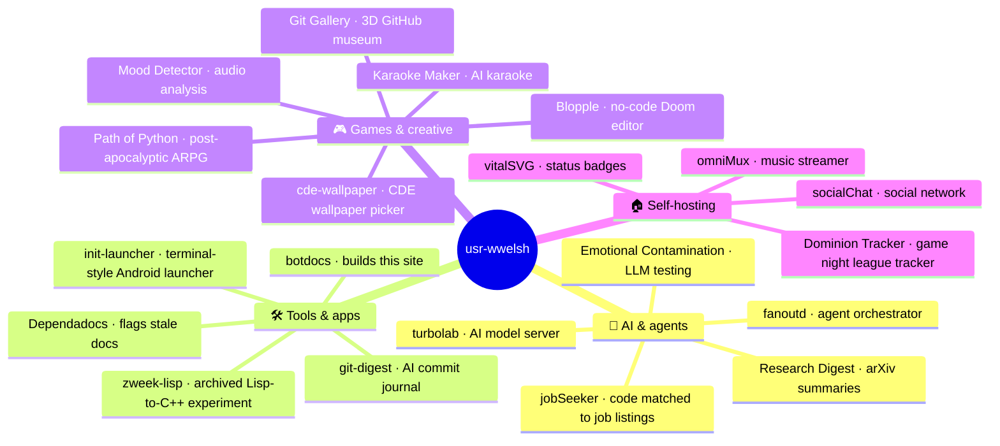

# usr-wwelsh docs

Hi, I'm William Welsh. I build free, open, offline-first tools, mostly single binaries you can run on your own hardware with no accounts, API keys or cloud. Everything is MIT.

This site gathers the docs for every public [usr-wwelsh](https://github.com/usr-wwelsh) repo. Each project's README and `docs/` folder get pulled in nightly, so it stays in sync with GitHub.

Search is semantic, so you can describe what you want instead of guessing a repo name.

## Try searching for

- `run Hugging Face models locally on CPU`
- `download music from YouTube and stream it on my phone`
- `status badge showing my server's CPU and RAM`
- `build a Doom-style game in the browser without code`
- `does hostile feedback make an LLM worse at reasoning`
- `summaries of new arXiv papers without an API key`
- `summarize my GitHub commits with an LLM`
- `run several AI agents in parallel on a kanban board`

## What's here

- **AI & agents**: run your own AI model server, orchestrate agents, summarize research papers, test how LLMs behave and match your code to job listings with [turbolab](./turbolab/README.html), [fanoutd](./fanoutd/README.html), [Research-Digest](./Research-Digest/README.html), [emotional-contamination](./emotional-contamination/README.html) and [jobSeeker](./jobSeeker/README.html)
- **Tools & apps**: [botdocs](./botdocs/README.html) builds this site, [Dependadocs](./Dependadocs/README.html) flags docs a PR made stale, [git-digest](./git-digest/README.html) journals your commits, [init-launcher](./init-launcher/README.html) is a terminal-style Android launcher and [zweek-lisp](./zweek-lisp/readme.html) is an archived Lisp-to-C++ experiment
- **Games & creative**: a no-code Doom-style editor, an ARPG, a 3D museum of GitHub, AI karaoke, audio analysis and a CDE wallpaper picker in [Blopple](./Blopple/README.html), [path-of-python](./path-of-python/README.html), [git-gallery](./git-gallery/README.html), [karaoke-maker](./karaoke-maker/README.html), [Mood-Detector](./Mood-Detector/README.html) and [cde-wallpaper](./cde-wallpaper/README.html)
- **Self-hosting**: run your own music streamer, social network, status badges and game night league tracker with [omniMux](./omniMux/README.html), [socialChat](./socialChat/README.html), [vitalSVG](./vitalSVG/README.html) and [dominion-tracker](./dominion-tracker/README.html)

## Elsewhere

- [Portfolio](https://wwel.sh)
- [GitHub](https://github.com/usr-wwelsh)
- [Code blog](https://wwel.sh/digest.html)
